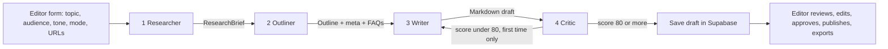
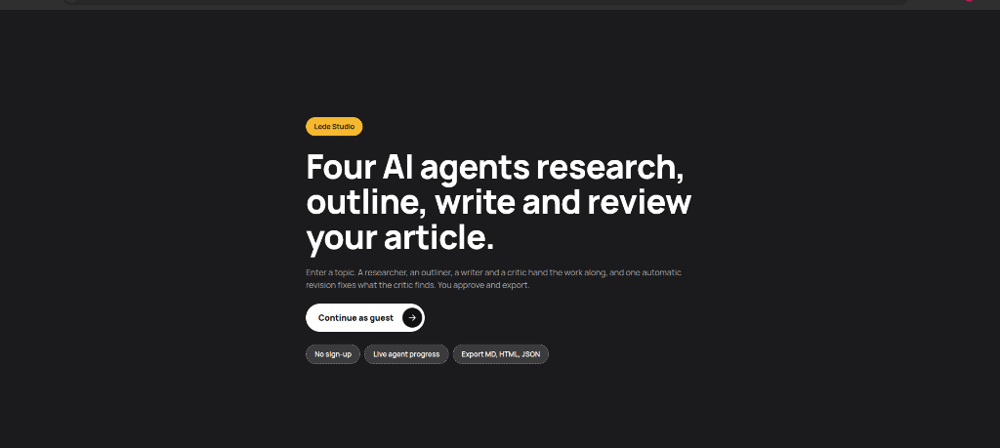
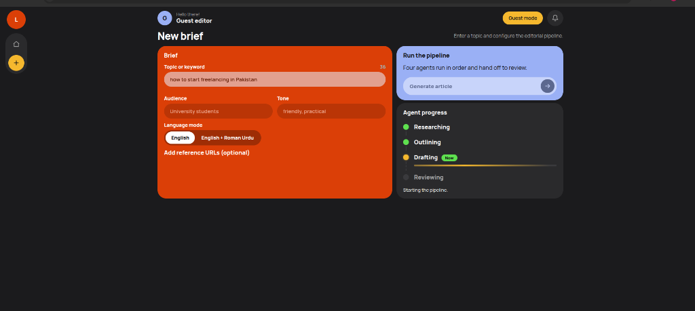
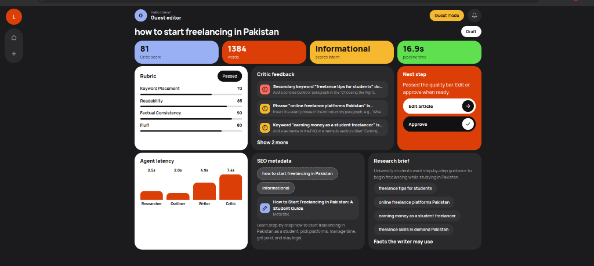
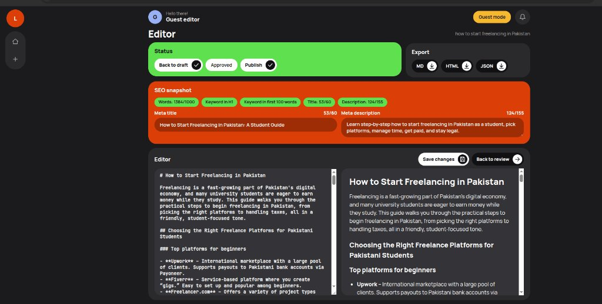
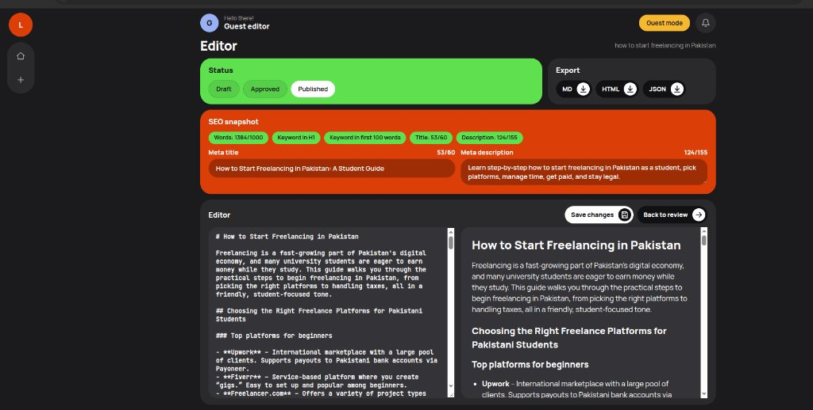

# Lede Studio: Multi-Agent SEO Content Engine

Four specialised AI agents research, outline, write and critique an article. A Critic score below 80 sends the draft back to the Writer once. A human editor approves and exports.

**Live app:** https://multi-agent-seo-content-engine-alch.vercel.app (first load after idle can be slow because of a cold start)

## Architecture



| Agent | Input | Output (Pydantic model) |
|---|---|---|
| Researcher | topic, audience, tone, mode, optional URLs | `ResearchBrief`: intent, keywords, angles, facts |
| Outliner | research brief | `Outline`: H1/H2/H3, meta title (60 max), meta description (155 max), FAQs |
| Writer | brief, outline, tone, mode, Critic feedback on revision | `Draft`: 1,000 to 1,500+ word Markdown, Roman Urdu summary in bilingual mode |
| Critic | draft, brief, outline, code check results | `CriticReport`: 4 rubric scores plus feedback |

**Trust rule:** the LLM does judgment. Python computes everything checkable (word count, keyword in H1 and first 100 words, character limits). If a hard check fails the final score is capped at 79, which triggers the revision. Each agent output is validated by Pydantic with up to 2 retries that include the error message.

Every agent step writes one row to `agent_runs` (tokens, latency). Each LLM call goes through one function in `app/llm/client.py` and one `BaseAgent` class runs all four agents.

## Setup

1. Create a Supabase project and run this SQL in the SQL editor (also in `sql/schema.sql`):

```sql
-- Run this once in the Supabase SQL editor.
create table if not exists articles (
  id bigint generated always as identity primary key,
  topic text not null,
  target_keyword text,
  search_intent text check (search_intent in ('Informational','Commercial','News Analysis')),
  meta_title text check (char_length(meta_title) <= 60),
  meta_description text check (char_length(meta_description) <= 155),
  outline_json jsonb,
  content_markdown text,
  bilingual_summary text,
  quality_score int check (quality_score between 0 and 100),
  status text not null default 'draft' check (status in ('draft','approved','published')),
  created_at timestamptz not null default now(),
  -- extra columns used by the dashboard
  audience text,
  tone text,
  mode text default 'english',
  research_brief_json jsonb,
  critic_report_json jsonb,
  updated_at timestamptz not null default now()
);

create table if not exists agent_runs (
  id bigint generated always as identity primary key,
  article_id bigint not null references articles(id) on delete cascade,
  agent_name text not null check (agent_name in
    ('researcher','outliner','writer','critic','writer_revision','critic_reaudit')),
  input_tokens int,
  output_tokens int,
  latency_ms int,
  critic_feedback_json jsonb,
  created_at timestamptz not null default now()
);

create index if not exists agent_runs_article_idx on agent_runs (article_id);
create index if not exists articles_status_idx on articles (status, created_at desc);

grant usage on schema public to service_role;
grant all on table public.articles to service_role;
grant all on table public.agent_runs to service_role;
grant usage, select on all sequences in schema public to service_role;
```

2. Copy `.env.example` to `.env` and fill in your keys. Never commit `.env`.
3. Run locally:

```bash
python -m venv .venv && source .venv/bin/activate
pip install -r requirements.txt
uvicorn main:app --reload
```

4. Open http://localhost:8000, click **Continue as guest**, enter a topic.
5. Tests (no API keys needed): `python -m pytest -q`
6. Smoke run against any server: `python scripts/smoke.py http://localhost:8000 "your topic"`

## Deploy on Vercel

Push to GitHub, import the repo in Vercel (framework shows as FastAPI), and add the `.env.example` variables under Project Settings. `main.py` at the root exposes the app, `public/` holds static files, and nothing is written to disk because Supabase stores all data.

## API

| Method and path | Purpose |
|---|---|
| `POST /api/generate` | Body: topic, audience, tone, mode, reference_urls. Streams SSE progress |
| `GET /api/articles` | List articles, optional `?status=` |
| `GET /api/articles/{id}` | Article plus its `agent_runs` |
| `PATCH /api/articles/{id}/status` | Enforced transitions: draft to approved to published |
| `PUT /api/articles/{id}` | Save the editor's Markdown and meta edits |
| `GET /api/articles/{id}/export?format=md\|html\|json` | Download an approved article |
| `GET /health` | Health check |

## Project layout

```
main.py                 Vercel entry
public/                 tokens.css (design tokens) and 4 small JS files
docs/screenshots/       App UI screenshots (Welcome, Generate, Review, Editor)
sql/schema.sql          Supabase schema
app/core/               config.py (env) and constants.py (all limits and names)
app/llm/                client.py, validated.py, providers/ (groq, gemini)
app/agents/             base.py, 4 agents, prompts/*.md
app/schemas/            Pydantic models
app/pipeline/           state, routing, LangGraph graph
app/checks/             seo.py (code checks), scoring.py (cap rule)
app/db/                 Supabase client and repositories
app/services/           export, SSE stream, reference URL fetch
app/api/ and app/web/   thin routes, Jinja templates and component macros
tests/                  schema, checks, router, status, fallback, pages and full pipeline loop
```

## Screenshots

| Screen | Preview |
|---|---|
| Welcome |  |
| Generate (live pipeline) |  |
| Review (Critic & telemetry) |  |
| Editor (Approved) |  |
| Editor (Published) |  |

## Sample output

Observed from a real run (`articles.id = 16`, total pipeline time `16.9s`, `1,384` words):

| Field | Value |
|---|---|
| Topic | how to start freelancing in Pakistan |
| Intent | Informational |
| Meta title | How to Start Freelancing in Pakistan: A Student Guide |
| Meta description | Learn step-by-step how to start freelancing in Pakistan as a student, pick platforms, manage time, get paid, and stay legal. |
| Final Critic score | 81 |

| Agent run | Latency | Input tokens | Output tokens |
|---|---|---|---|
| researcher | 2.5s (`2539ms`) | 710 | 388 |
| outliner | 2.0s (`2030ms`) | 950 | 628 |
| writer | 4.9s (`4912ms`) | 1193 | 2066 |
| critic | 7.4s (`7369ms`) | 3270 | 608 |
| writer_revision (if triggered) | — | — | — |
| critic_reaudit (if triggered) | — | — | — |

## Limitations and future work

- Reference URL fetching is basic text extraction. A hardened fetcher would block private network addresses.
- Guest mode has no authentication, so anyone with the link is an editor.
- Possible additions: articles list page, analytics from `agent_runs`, topic suggestions.
